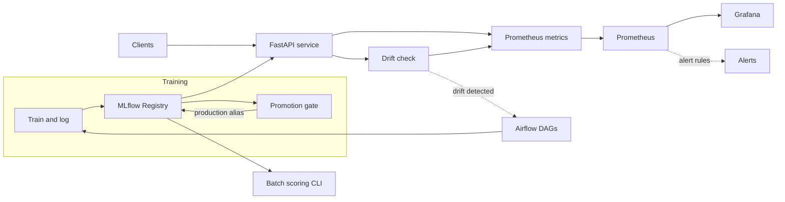

# mlops-model-serving

[](https://github.com/Beru47/mlops-model-serving/actions/workflows/ci.yml)

A small, end-to-end MLOps reference project: **MLflow Model Registry**, **batch and real-time serving** (FastAPI), **drift monitoring** (PSI + KS) with **Prometheus alerts and a Grafana dashboard**, and **Airflow-scheduled retraining** with a promotion gate.

It is a personal reference project on a **seeded synthetic dataset** (housing-style regression). It is not a production system and makes no claim of production use. Every number below is produced by code in this repo.

## Architecture



## Model lifecycle

1. `train_candidate` fits a model, logs params, the holdout RMSE and the **model signature**, registers a new version and points the alias `staging` at it. It also stores a reference sample of the training features as a run artifact.
2. `evaluate` scores the candidate **and** the current `production` version on the same fixed, drift-free holdout.
3. `promote_if_better` moves the `production` alias to the candidate only if the gate passes.
4. The API loads `models:/<name>@production`; `POST /reload` picks up a new version without a restart.

Aliases are used instead of the deprecated registry stages.

## Promotion gate

A candidate becomes Production only if `candidate_rmse < production_rmse * (1 - min_improvement)`. The first model is promoted; ties and regressions never ship (`src/mlops/promotion.py`, tested in `tests/`). Training is idempotent per run key, and promotion is a no-op if the version is already Production, so Airflow retries are safe.

## Drift monitoring: why PSI and KS

- **PSI** (quantile bins from the reference) measures the *size* of a shift. Rule of thumb: above 0.2 is significant.
- **KS two-sample test** measures whether a shift is *statistically significant*.
- With few rows KS is noisy, and with many rows it flags trivial shifts. A feature counts as drifted only when **both** agree (PSI > 0.2 and KS p < 0.01), which cuts false alarms.

The API keeps a rolling window of live inputs and recomputes drift every 15 s, exposing `feature_drift_psi{feature}`, `feature_drift_ks_pvalue{feature}` and `drift_detected`. Prometheus rules are in `monitoring/alerts.yml` (drift, high PSI, high p95 latency, error rate); the dashboard is `monitoring/grafana/dashboards/model-serving.json`. Injected covariate shift (`--shift 1.5`) on this dataset gives `drift_detected = 1` (PSI about 5.6 on `med_inc`).

## Measured latency

`python -m mlops.loadtest` (async httpx, 50 warm-up requests excluded), API and client on the same machine, one uvicorn worker, no errors.

| Test | p50 | p95 | p99 | throughput |
|---|---|---|---|---|
| `/predict`, 1 row, concurrency 1 (run A) | 37.3 ms | 105.4 ms | n/a | 19 req/s |
| `/predict`, 1 row, concurrency 1 (run B) | 27.3 ms | 48.6 ms | 78.0 ms | 33 req/s |
| `/predict/batch`, 100 rows, concurrency 1 | 30.4 ms | 51.9 ms | 63.2 ms | 30 req/s (about 3,000 rows/s) |

Machine: Intel Core i5-9300H (4 cores), Windows 10, Python 3.13, a busy developer laptop. Run-to-run variance is large (compare A and B), so **I do not claim a stable p95 target on this machine**; the 50 ms p95 alert threshold in `alerts.yml` is a configurable SLO example, not a result. Higher concurrency was not benchmarked. Single-row inference is pinned to one thread (`threadpoolctl`) because OpenMP fan-out made it much slower.

## Run it

```bash
pip install -e ".[dev]"
make train                 # trains, registers, promotes (sqlite registry in ./mlflow.db)
make serve                 # http://localhost:8000 (/docs, /metrics)
make loadtest              # p50/p95/p99
make drift-traffic         # send shifted traffic, then GET /drift
make batch                 # CSV in, CSV out
make test lint
docker compose up --build  # API + Prometheus (127.0.0.1:9090) + Grafana (127.0.0.1:3000)
```

Grafana allows anonymous viewing; set `GRAFANA_ADMIN_PASSWORD` in a local `.env`. All ports bind to loopback. The compose stack has not been run in CI.

Airflow: `dags/retrain.py` defines `retrain` (weekly: train, evaluate, promote, reload API) and `drift_check` (hourly: polls `/drift`, triggers `retrain`). Install the package on the Airflow workers and set `MODEL_API_URL` and `MLFLOW_TRACKING_URI`. The DAG file is not exercised by the test suite or CI; the logic it calls (`mlops.pipeline`) is.

## Structure

```
src/mlops/   config, data, pipeline (train/evaluate/promote), promotion, serve, batch, drift, loadtest
dags/        Airflow DAGs
monitoring/  prometheus.yml, alerts.yml, Grafana provisioning + dashboard
tests/       promotion gate, drift math, pipeline + API
.github/     CI: ruff, pytest, train-and-register smoke run
```

## Roadmap

- Databricks Model Serving (Unity Catalog registry) as an alternative backend
- Canary / shadow deployment between `production` and `staging`
- Feature store for consistent training and serving features
- Label feedback for performance monitoring (today only input drift is monitored)
